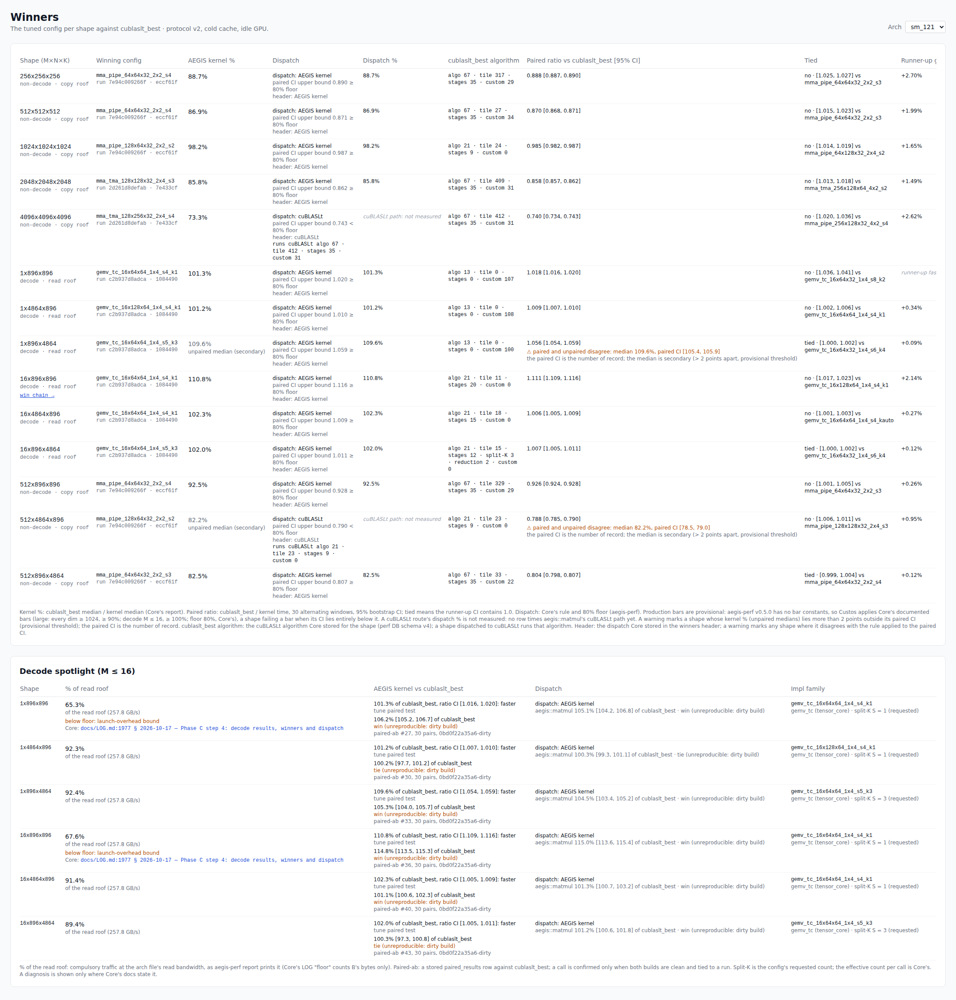
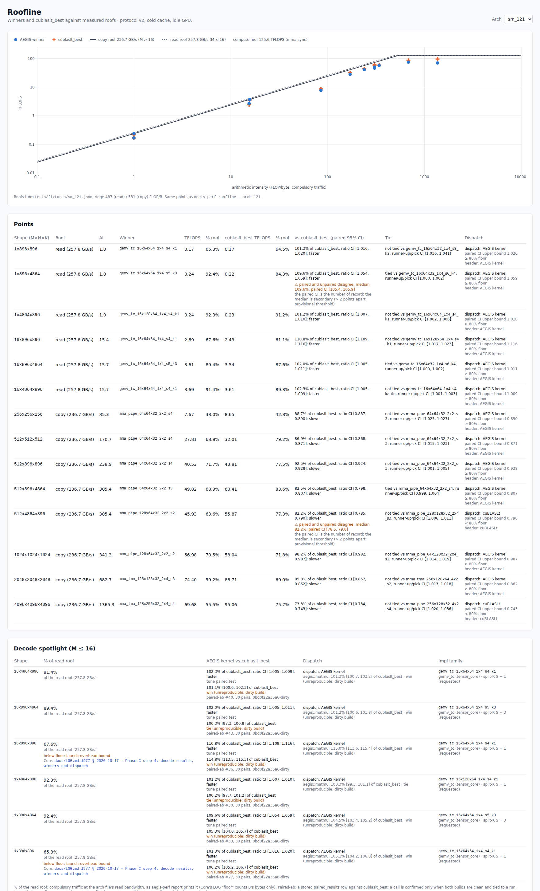
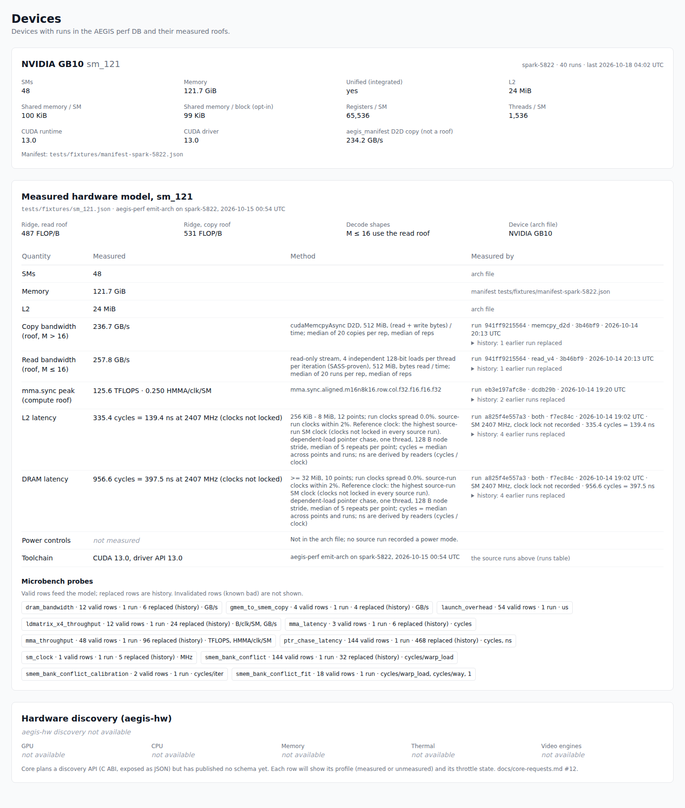
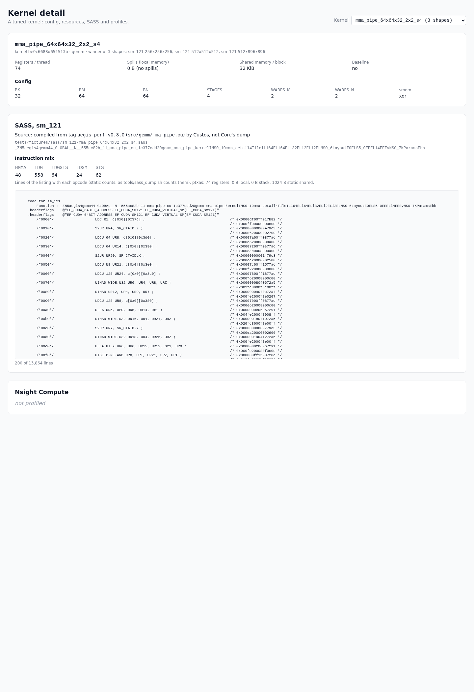
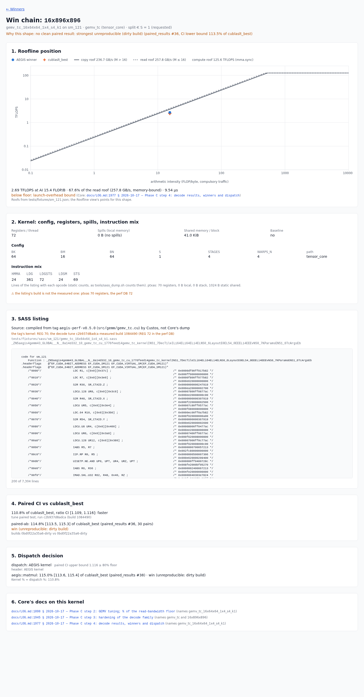
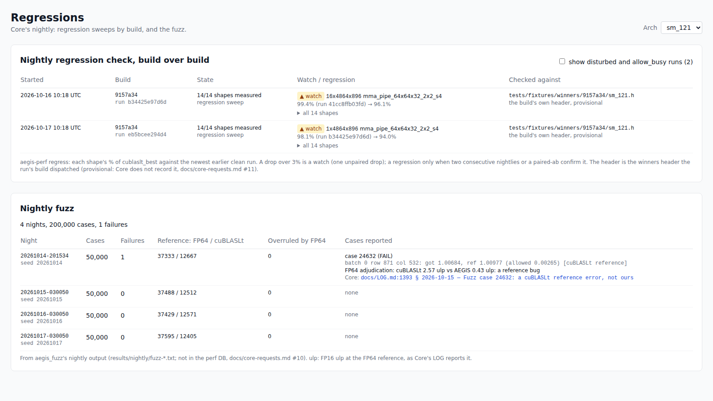
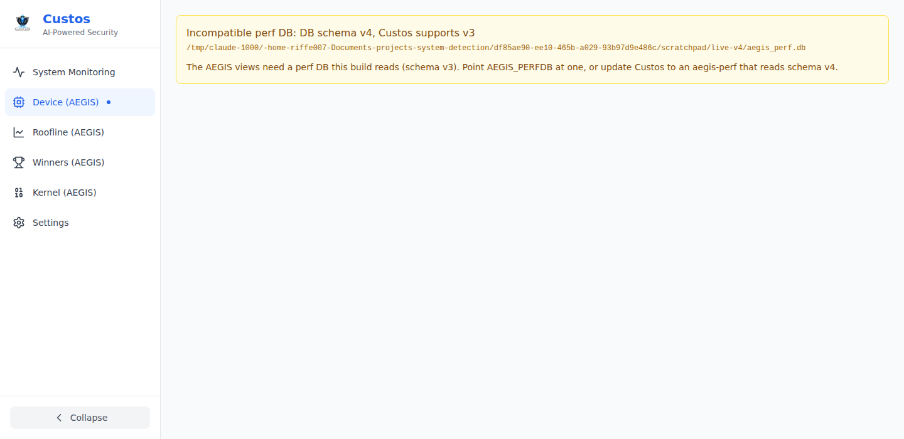

# 🔧 Rust System Monitor

A **real-time, cross-platform system monitoring application** built with **Tauri v2** (Rust backend + React frontend).
Collects comprehensive CPU, memory, GPU, disk, network, and process metrics using a clean architecture and extensible backend. Designed as a professional-grade foundation for system diagnostics, embedded monitoring tools, or performance dashboards.

### Screenshots: the AEGIS Custos perf views

| Winners | Roofline |
|---|---|
|  |  |
| **Device** | **Kernel detail** |
|  |  |
| **Win chain** (one decode win, from its Winners row) | **Regressions** (nightly check by build, nightly fuzz) |
|  |  |

An unusable perf DB shows only its state:


Dark mode and what each shot shows: [`docs/screenshots/`](docs/screenshots/README.md).

---

## ✨ Features

- **Written in Rust** for speed, safety, and low-level control
- **Tauri v2** for cross-platform desktop applications
- **Real-time monitoring** with 1-second update intervals
- **GPU monitoring** with NVIDIA NVML support (temperature, usage, memory, power)
- **Interactive dashboard** with draggable, customizable widgets
- **Live charts** and historical data visualization
- **Dark/light theme** support
- **Responsive design** that adapts to different screen sizes
- **Process monitoring** with top processes by CPU/memory usage
- **Network monitoring** with real-time bandwidth tracking
- **Disk monitoring** with I/O rate tracking
- **Enterprise-grade** threat detection and security monitoring

---

## AEGIS Custos (GPU performance views)

The app is becoming AEGIS Custos, a GPU performance-engineering workstation
over the AEGIS Core perf DB. The perf views (Device, Roofline, Winners,
Kernel) read Core's data read-only through `aegis-perf`, Core's own library,
pinned to a release tag (`custos-perf/Cargo.toml`, now `aegis-perf-v0.5.0`).

### Feature flag

| Build | Rust | Frontend |
|---|---|---|
| Custos (default) | feature `aegis` (default) | default |
| Original system monitor | `--no-default-features` | `VITE_AEGIS=0` |

```bash
pnpm tauri:dev                 # Custos
pnpm tauri:dev:monitor         # system monitor only: VITE_AEGIS=0 tauri dev -- --no-default-features
```

### Data sources

- `AEGIS_CORE`: a Core checkout (arch files, manifests, SASS and Nsight
  artifacts); `AEGIS_PERFDB`: the perf DB (default `$AEGIS_CORE/results/aegis_perf.db`).
- Neither set: the committed fixtures in `tests/fixtures/` (what the tests use).

At startup the app checks the DB's schema version against the range
aegis-perf supports (perf DB schema v4 for v0.4.0 and v0.5.0) and shows "Incompatible
perf DB: DB schema vN, Custos supports vA" instead of the views when it is
outside it.

### Building on a fresh machine

- Rust (stable), Node 18+, pnpm 10 (`corepack enable`; `packageManager` in
  `package.json`), and the Tauri 2 system packages (webkit2gtk etc.).
- **Git access to https://github.com/Riffe007/aegis-core**, also for
  `--no-default-features`: Cargo resolves optional git dependencies when it
  loads the lockfile, so it fetches aegis-core even when the `aegis` feature is
  off (checked: offline, without a git checkout of aegis-core,
  `cargo metadata --no-default-features` fails with "failed to get `aegis-perf`").
  The repository is public (GitHub API, 2026-10-17: `"visibility": "public"`),
  so no credentials are needed.
- No GPU and no CUDA: aegis-perf is pure Rust and the views read files.

```bash
pnpm install --frozen-lockfile
cargo test --manifest-path custos-perf/Cargo.toml    # data layer, on tests/fixtures/
cargo test --manifest-path src-tauri/Cargo.toml      # app (add --no-default-features for the monitor)
pnpm typecheck && pnpm vitest run
```

### Local aegis-perf override (development only)

To build against a local aegis-perf, for example while a Core change is in
review, add a `[patch]` in `.cargo/config.toml` at the repo root (gitignored).
Point it at a separate Core clone or `git worktree`, never Core's main working
tree:

```toml
# .cargo/config.toml (not committed)
[patch."https://github.com/Riffe007/aegis-core"]
aegis-perf = { path = "/path/to/aegis-core-worktree/rust/aegis-perf" }
```

Cargo reads it for every command run inside the repo, and while it is active
it rewrites the `aegis-perf` entry in `Cargo.lock` (do not commit that).
Remove it (or rename the file) to build from the pinned tag again; tests
and CI always use the pin.
`cargo tree -i aegis-perf --manifest-path custos-perf/Cargo.toml` shows which
one is in use (a path, or `?tag=aegis-perf-v0.5.0#9f3f41cc`).

---

## 🚀 Getting Started

### ✅ Requirements

- **Rust** (latest stable version)
- **Node.js** (v18 or later)
- **pnpm** (recommended) or npm
- **NVIDIA drivers** (for GPU monitoring - optional)

### 🔨 Build & Run

Clone the repository:

```bash
git clone https://github.com/Riffe/system-detection.git
cd system-detection
```

Install dependencies:

```bash
pnpm install
```

Build and run in development mode:

```bash
pnpm run tauri dev
```

Build for production:

```bash
pnpm run tauri build
```

### 🎯 Running the Application

**Important**: This application requires the Tauri runtime and cannot run in a regular browser. The application will show an error if launched in a browser environment.

When running correctly, you'll see:
- A **native application window** (not a browser tab)
- **Real system data** (no mock data)
- **Live updating metrics** every second
- **Interactive dashboard** with draggable widgets

---

## 📊 Monitoring Capabilities

### CPU Monitoring
- **Real-time usage** percentage
- **Per-core usage** visualization
- **Frequency** monitoring
- **Load average** (1, 5, 15 minute)
- **Process count** (running/total)

### Memory Monitoring
- **Total/used/available** memory
- **Swap usage** monitoring
- **Memory pressure** indicators
- **Real-time charts**

### GPU Monitoring (NVIDIA)
- **GPU usage** percentage
- **Memory usage** and capacity
- **Temperature** monitoring
- **Power draw** in watts
- **Clock speeds** (core/memory)
- **Fan speed** (if available)
- **Multi-GPU** support

### Disk Monitoring
- **Space usage** by mount point
- **I/O rates** (read/write bytes per second)
- **File system** information
- **Real-time bandwidth** tracking

### Network Monitoring
- **Interface status** and statistics
- **Bandwidth usage** (bytes sent/received per second)
- **Packet statistics**
- **Network interface** details

### Process Monitoring
- **Top processes** by CPU usage
- **Memory usage** per process
- **Process status** and details
- **Real-time updates**

---

## 🏗️ Architecture Overview

### Backend (Rust/Tauri)
- **`src-tauri/src/monitoring.rs`**: Core monitoring service using `sysinfo` crate
- **Async metrics collection**: Tokio-based background monitoring
- **Event-driven updates**: Real-time metrics pushed to frontend
- **GPU monitoring**: NVIDIA NVML integration for GPU metrics
- **Rate calculation**: Real-time I/O and network rate tracking

### Frontend (React/TypeScript)
- **Modern React 18** with hooks and functional components
- **Tailwind CSS** for styling with dark/light theme support
- **Recharts** for data visualization
- **Drag-and-drop dashboard** using `@dnd-kit`
- **Responsive grid layout** with customizable widgets

### Key Components
- **`AppWrapper.tsx`**: Main application logic and Tauri integration
- **`DraggableDashboard.tsx`**: Interactive dashboard with widget management
- **Monitor Components**: Individual monitoring widgets (CPU, Memory, GPU, etc.)
- **`useMetricsHistory.ts`**: Custom hook for historical data tracking

---

## 🔧 Configuration

### GPU Monitoring
GPU monitoring requires:
1. **NVIDIA GPU** with supported drivers
2. **NVML library** (included via `nvml-wrapper` crate)
3. **Feature flag enabled** (enabled by default)

To disable GPU monitoring:
```toml
# In Cargo.toml
[features]
default = []  # Remove "nvidia"
```

### Dashboard Customization
- **Drag and drop** widgets to reorder
- **Resize widgets** (small, medium, large, full-width)
- **Show/hide widgets** in edit mode
- **Layout persistence** (saved to localStorage)

---

## 🧪 Testing

Run all tests:

```bash
pnpm run test:all
```

Run specific test suites:

```bash
# Frontend tests
pnpm run test

# Rust backend tests
pnpm run test:rust

# Test coverage
pnpm run test:coverage
```

---

## 🐛 Troubleshooting

### Common Issues

1. **"Tauri environment not detected"**
   - Ensure you're running through Tauri, not in a browser
   - Use `pnpm run tauri dev` to launch

2. **GPU monitoring not working**
   - Verify NVIDIA drivers are installed
   - Check that `nvml-wrapper` feature is enabled
   - Ensure you have an NVIDIA GPU

3. **High CPU usage**
   - The app updates every second by default
   - Consider reducing update frequency for older systems

4. **Permission errors**
   - The app needs system access for monitoring
   - Grant necessary permissions when prompted

### Debug Mode
Enable debug logging by setting the `RUST_LOG` environment variable:

```bash
RUST_LOG=debug pnpm run tauri dev
```

---

## How this was built

Built with Claude Code as an implementation tool. Architecture, the data
contract, measurement methodology, and review were mine; every number traces
to a measured run.

---

## 🪪 License

**Proprietary Software**
Copyright (c) 2026 NexGen Tech AI. All rights reserved.

This software is proprietary and confidential. Unauthorized copying, modification, distribution, or use is strictly prohibited. See the LICENSE file for complete terms and conditions.

---

## 🙋 Support

For technical support, licensing inquiries, or feature requests, please contact:
- Email: timothy@riffeandassociates.com
- Website: https://www.riffe.tech

### Technical Specifications
- **No mock data**: All features work with real system data
- **Real-time updates**: All metrics update live
- **Cross-platform**: Compatible across Windows, macOS, and Linux
- **Performance**: Optimized for minimal system impact

---

## 📫 Contact

Want to connect or collaborate on systems-level tools, optimization research, or AI infrastructure?

Reach out at timothy@riffeandassociates.com or visit https://www.riffe.tech 
```

